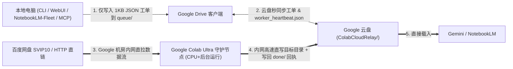

# ⚡ Colab-Cloud-Relay

[](https://colab.research.google.com/github/wangsiyi7/Colab-Cloud-Relay/blob/main/notebooks/Colab_Cloud_Relay.ipynb)

将 **Google Colab（推荐 Google AI Ultra 1000 积分 · CPU + 高内存 + 后台运行）** 变成一台 **永久在线、队列驱动、可插拔式** 的零 VPN 云端网盘与直传节点：

- **0 本机硬盘占用 · 0 家宽下行 · 0 VPN 流量**：所有百度网盘 SVIP10 文件流、HTTP/HTTPS 离线大文件，全部在 Google 机房内网直写入你的 Google Drive（`/content/drive/MyDrive/`）。
- **一次部署，永久复用，不改代码派发新任务**：在 Colab 启动主守护节点 `notebooks/Colab_Cloud_Relay.ipynb` 后，本地电脑随时通过 CLI / Web UI / FastAPI 插件 / MCP 往 Google Drive `ColabCloudRelay/queue/` 投递 JSON 工单，Colab 自动领取并写回进度与心跳。
- **即插即用插件化架构**：一行 `app.include_router(create_colab_relay_router())` 即可嵌入 `NotebookLM-Fleet` 或任何 FastAPI 项目，也内置 7 个 FastMCP 工具与独立 Web 控制台。
- **零明文密钥落盘**：`.ipynb` 与队列 JSON 内绝不保存任何百度 Cookie/Token，Colab 仅在内存读取 `google.colab.userdata.get('BAIDU_COOKIE')`。

---

## 工作原理（为什么完全不走本机 VPN 与硬盘）



---

## 30 秒极速上手

### 1. 安装（独立运行或作为插件嵌入任意项目）

```bash
pip install -e .
```

### 2. 一键自动配置 + 复制百度 Cookie + 外部浏览器打开 Colab

```bash
colab-relay setup --copy-cookie --open
```

该命令会自动完成：
1. 自动探测本机挂载的 Google 云盘根目录；
2. 初始化 `<GoogleDrive>/ColabCloudRelay/{queue,running,done,failed,logs,notebooks}`；
3. 自动同步最新主控笔记本 `Colab_Cloud_Relay.ipynb`；
4. 自动关联本机已登录的百度网盘凭据并安全复制 `BAIDU_COOKIE` 到剪贴板（不打印到屏幕）；
5. 在你的外部浏览器打开 [Colab-Cloud-Relay 主节点](https://colab.research.google.com/github/wangsiyi7/Colab-Cloud-Relay/blob/main/notebooks/Colab_Cloud_Relay.ipynb)。

### 3. 在 Colab 中完成最后两步

1. 点击左侧边栏 **🔑 Secrets** → 新增 `BAIDU_COOKIE` → `Ctrl+V` 粘贴并打开开关（以后所有任务永久复用）；
2. 右上角运行时选择 **CPU + 高内存 + 后台运行**（几乎不消耗 1000 积分），按 **`Ctrl+F9` 全部运行**！

---

## 作为独立插件嵌入其他系统

### FastAPI 一行挂载

```python
from fastapi import FastAPI
from colab_cloud_relay import create_colab_relay_router

app = FastAPI()
app.include_router(create_colab_relay_router(prefix="/api/colab-relay"))
```

### CLI 常用命令

```bash
colab-relay status                                              # 查看云盘、Colab 节点心跳、队列数量
colab-relay enqueue --kind baidu_to_gdrive --src "/资料目录"     # 下发百度->Google迁移工单
colab-relay enqueue --kind url_to_gdrive --url "https://..."    # 下发免本地流量离线下载工单
colab-relay serve --port 8775 --open                            # 启动独立 Web 控制台
```

### MCP Server (`colab-relay-mcp`)

提供 7 个标准工具：`relay_auto_config`、`relay_status`、`relay_enqueue_baidu_to_gdrive`、`relay_enqueue_gdrive_to_baidu`、`relay_enqueue_url_to_gdrive`、`relay_jobs`、`relay_open_colab`。
